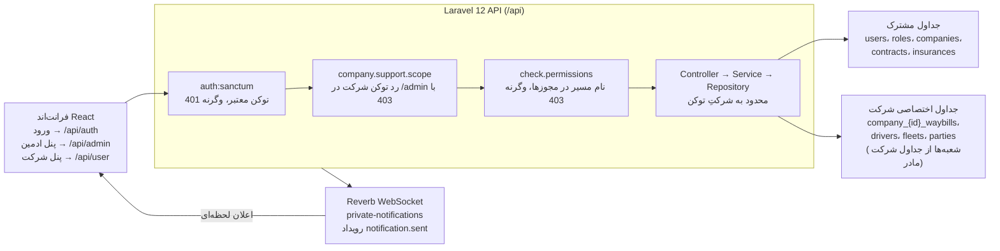
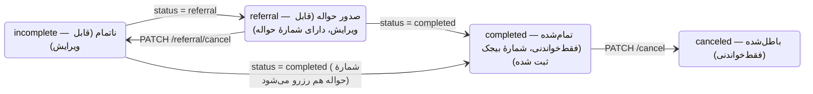

# راهنمای یکپارچه‌سازی API بیجک

۲۵ مهر ۱۴۰۵ (17 Oct 2026) · @reza

این راهنما قرارداد میان API لاراول ۱۲ بیجک و فرانت‌اند React است: همهٔ مسیرها، بدنهٔ درخواست‌ها، پاسخ‌ها و قواعدی که
فرانت‌اند لازم دارد، به شکلی نوشته شده که هم یک توسعه‌دهنده و هم یک دستیار هوش مصنوعی بتواند مستقیماً بر اساس آن
پیاده‌سازی کند.

## ۱. نمای کلی

اپلیکیشن React فقط با یک API لاراول ۱۲ صحبت می‌کند. هر درخواست پنل شرکت سه بررسی را می‌گذراند: توکن معتبر، محدودهٔ شرکت
درست و مجوزِ نام مسیر. بعد از آن فقط دادهٔ همان شرکت را می‌خواند.



داده‌های عملیاتی هر شرکت (بارنامه‌ها، رانندگان، ناوگان، طرفین حمل، بازه‌های شماره) در جداول `company_{id}_*` خودش
نگهداری می‌شود و شعبه از جداول شرکت مادر استفاده می‌کند. هویت، نقش‌ها، شرکت‌ها، قراردادها و بیمه‌ها جداول مشترکی هستند
که با `company_id` فیلتر می‌شوند. فرانت‌اند هیچ‌وقت شناسهٔ شرکت را ارسال نمی‌کند؛ توکن آن را تعیین می‌کند.

## ۲. قراردادهای کلی

همهٔ endpointها JSON هستند، زیر `/api` قرار دارند، با توکن bearer سنکتوم احراز هویت می‌شوند و در یک قالب پاسخ واحد
برمی‌گردند.

### ۲.۱ آدرس پایه و هدرها

| مورد           | مقدار                                                               |
|----------------|---------------------------------------------------------------------|
| آدرس پایه      | `APP_URL` + `/api` (در env نمونه `https://api.bijak724.ir`)         |
| هدر احراز هویت | `Authorization: Bearer <token>` در همهٔ مسیرها به‌جز login            |
| Accept         | سمت سرور روی `application/json` اجبار می‌شود؛ با این حال ارسالش کنید |
| بدنه           | JSON؛ `multipart/form-data` فقط برای آپلود تصویر                    |
| زبان           | `fa`: پیام‌ها و خطاهای اعتبارسنجی فارسی برمی‌گردند                    |
| منطقهٔ زمانی    | `Asia/Tehran`؛ تاریخ‌ها `YYYY-MM-DD` و ساعت‌ها `HH:mm`                |
| بررسی سلامت    | `GET /up` (خارج از `/api`)                                          |

### ۲.۲ گروه‌های مسیر

| پیشوند       | پیشوند نام مسیر      | فراخوان                                         |
|--------------|----------------------|-------------------------------------------------|
| `/api/auth`  | `auth.`              | همه: ورود، بررسی توکن، خروج                     |
| `/api/user`  | `user.` و `profile.` | پنل شرکت: کاربران شرکت و توکن‌های پشتیبانی ادمین |
| `/api/admin` | `admin.`             | پنل مدیریت سیستم؛ توکن‌های شرکت با 403 رد می‌شوند |

پارامترهای عددی مسیر (`{user}`، `{waybill}`، `{transportContract}` و بقیه) فقط با رقم تطبیق پیدا می‌کنند؛ هر مقدار دیگری
404 برمی‌گرداند.

### ۲.۳ قالب پاسخ موفق

```json
{
  "success": true,
  "message": "عملیات موفق بود",
  "data": { }
}
```

`data` برای یک رکورد، شیء است؛ برای لیست بدون صفحه‌بندی، آرایه؛ و برای لیست صفحه‌بندی‌شده، شیء paginator. ایجاد، کد
`201` و بقیهٔ عملیات `200` برمی‌گردانند. حذف، `data: []` و یک پیام موفقیت فارسی برمی‌گرداند.

### ۲.۴ قالب خطاها

| وضعیت      | چه زمانی                                             | بدنه                                                                                    |
|------------|------------------------------------------------------|-----------------------------------------------------------------------------------------|
| 422        | خطای اعتبارسنجی یا نقض یک قاعدهٔ کسب‌وکار              | `{ success: false, message, errors: { field: ["..."] } }`                               |
| 401        | توکن ارسال نشده، منقضی یا باطل شده                   | فقط `{ message }` (بدون کلید `success`)                                                 |
| 403        | نبودِ مجوز برای نام مسیر، یا توکن شرکت روی مسیر ادمین | `{ message }` از بررسی مجوز؛ `{ success: false, message, errors }` از بررسی محدودهٔ شرکت |
| 404        | مسیر ناشناخته یا رکوردی خارج از شرکت جاری            | `{ success: false, message, errors: { error: ["..."] } }`                               |
| 429        | عبور از محدودیت نرخ درخواست                          | `{ success: false, message, errors }`                                                   |
| 400 و سایر | خطاهای پرتاب‌شده از سرویس (`ErrorException`)          | `{ success: false, message, errors: { error: ["..."] } }`                               |

خطای فیلدهای تودرتو با مسیر نقطه‌ای می‌آید، مثل `items.3.primary_value` یا `cargos.0.cargo_id`. `success === false` یا
`status >= 400` را شکست در نظر بگیرید و همیشه `message` را به‌عنوان متن قابل نمایش به کاربر بخوانید.

### ۲.۵ لیست‌ها: صفحه‌بندی، جست‌وجو، فیلتر، مرتب‌سازی

endpointهای لیست همه از یک دستور query string مشترک (trait `AdvancedSearch`) پیروی می‌کنند:

| پارامتر                           | اثر                                                            |
|-----------------------------------|----------------------------------------------------------------|
| `paginate=1`                      | paginator لاراول برمی‌گرداند؛ بدون آن، آرایهٔ ساده از همهٔ ردیف‌ها |
| `itemsPerPage=N`                  | اندازهٔ صفحه، بین ۱ تا ۱۰۰، پیش‌فرض ۱۰                           |
| `page=N`                          | شمارهٔ صفحه                                                     |
| `search=text`                     | `LIKE %text%` روی ستون‌های جست‌وجوی سراسری مدل                   |
| `<field>=x`                       | `LIKE %x%` روی یک فیلد قابل جست‌وجو                             |
| `eq-<field>=x`                    | تطابق دقیق                                                     |
| `notEq-<field>=x`                 | نابرابر                                                        |
| `min-<field>=x` / `max-<field>=x` | `>=` / `<=`، برای تاریخ‌ها و مبالغ                              |
| `<relation>__<field>=x`           | فیلتر از طریق رابطه، مثل `cargos__cargo_id`                    |
| `is_parent=1`                     | فقط ردیف‌های بدون `parent_id`                                   |
| `order_field=<field>`             | ستون مرتب‌سازی؛ فیلد ناشناخته به `id` برمی‌گردد                  |
| `order_type=ASC\|DESC`            | پیش‌فرض `DESC`                                                  |

کلیدهای فیلتر ناشناخته نادیده گرفته می‌شوند، نه رد. `data` صفحه‌بندی‌شده این شکل را دارد:

```json
{
  "current_page": 1,
  "data": [],
  "first_page_url": "...",
  "from": 1,
  "last_page": 5,
  "last_page_url": "...",
  "links": [],
  "next_page_url": "...",
  "path": "...",
  "per_page": 10,
  "prev_page_url": null,
  "to": 10,
  "total": 48
}
```

### ۲.۶ مقادیر بولی و null

مقادیر بولی واقعی JSON بفرستید. بعضی درخواست‌ها رشته‌های `"true"`/`"false"` را هم می‌پذیرند (مثلاً پرچم‌های پیش‌فرض
قرارداد حمل)، اما به آن تکیه نکنید. برای پاک کردن یک فیلد nullable مقدار `null` بفرستید؛ حذف یک کلید از درخواست PATCH
مقدار ذخیره‌شده را حفظ می‌کند.

## ۳. احراز هویت

با نام کاربری و رمز عبور وارد شوید، توکن سنکتوم برگشتی را ذخیره کنید و آن را به‌عنوان bearer token بفرستید. abilityهای
توکن تعیین می‌کنند نشست مربوط به ادمین سیستم است، کاربر شرکت، یا ادمینی که به‌جای شرکت وارد شده.

### ۳.۱ endpointها

| متد  | مسیر                                      | بدنه                     | خروجی                                                                                                                                |
|------|-------------------------------------------|--------------------------|--------------------------------------------------------------------------------------------------------------------------------------|
| POST | `/api/auth/login`                         | `{ username, password }` | زمینهٔ احراز هویت + `token`                                                                                                           |
| GET  | `/api/auth/checkToken`                    | ندارد                    | زمینهٔ احراز هویت (بدون توکن جدید)                                                                                                    |
| POST | `/api/auth/logout`                        | ندارد                    | `data: []`؛ فقط توکن جاری را باطل می‌کند                                                                                              |
| POST | `/api/admin/companies/{company}/login-as` | ندارد                    | `201` + زمینهٔ احراز هویت + `token` پشتیبانی برای آن شرکت؛ مجوز `admin.companies.loginAs`، فراخوان باید سوپرادمین یا نقش `admin` باشد |

### ۳.۲ زمینهٔ احراز هویت (`data`)

```json
{
  "token": "12|plain-text-token",
  "user": { "id": 7, "company_id": 1000, "full_name": "...", "username": "...", "status": "active", "profile_image_url": null, "...": "UserResource" },
  "role": { "id": 3, "name": "companyManager", "display_name": "..." },
  "permissions": ["user.waybills.index", "user.waybills.store"],
  "auth_mode": "company",
  "company_access": {
    "access_type": "company_user",
    "company": { "id": 1000, "name": "...", "...": "CompanyResource" },
    "issued_by": { "id": 7, "full_name": "..." },
    "permissions": [],
    "expires_at": null
  }
}
```

`token` فقط در پاسخ ورود و پاسخ توکن پشتیبانی وجود دارد. وقتی `auth_mode` برابر `system` است، `company_access` وجود
ندارد.

### ۳.۳ حالت‌های نشست

| `auth_mode`       | چه کسی                            | abilityهای توکن                   | انقضا | مسیرهای مجاز                                                         |
|-------------------|-----------------------------------|-----------------------------------|-------|----------------------------------------------------------------------|
| `system`          | کاربر بدون `company_id` (ادمین‌ها) | `*`                               | ندارد | `/api/admin/*`؛ `/api/user/*` به دلیل نبودِ زمینهٔ شرکت 403 برمی‌گرداند |
| `company`         | کاربر عضو یک شرکت                 | `company-user`، `company:{id}`    | ندارد | فقط `/api/user/*`؛ مسیرهای ادمین 403                                 |
| `company_support` | ادمینی که توکن پشتیبانی صادر کرده | `company-support`، `company:{id}` | ۱ روز | `/api/user/*` همان شرکت، محدود به مجوزهای فعالِ نقش `companyManager`  |

### ۳.۴ جریان در فرانت‌اند

1. `POST /auth/login`؛ مقادیر `token`، `auth_mode`، `permissions` و `company_access` را ذخیره کنید.
2. اگر `auth_mode === "system"` بود به پنل ادمین، وگرنه به پنل شرکت بروید.
3. هنگام شروع اپ، `GET /auth/checkToken` را برای بازیابی نشست صدا بزنید؛ 401 یعنی خروج محلی.
4. برای «ورود به شرکت به‌عنوان پشتیبان»، endpoint توکن پشتیبانی را با توکن ادمین صدا بزنید. توکن ادمین را نگه دارید:
   توکن پشتیبانی در مسیرهای ادمین رد می‌شود. برای بازگشت، توکن پشتیبانی را دور بریزید.
5. برای نشست پشتیبانی، شمارش معکوس از `company_access.expires_at` نمایش دهید؛ پس از آن همهٔ درخواست‌ها 401 برمی‌گردانند.
6. `POST /auth/logout` فقط همان توکنی را باطل می‌کند که با آن صدا زده شده.

خطاهای ورود با کد 400 و پیام فارسی برمی‌گردند: کاربر پیدا نشد، رمز اشتباه، کاربر غیرفعال (403)، کاربر بدون نقش (403) یا
شرکت غیرفعال (403).

## ۴. مجوزها و نقش‌ها

هر مجوز همان نام یک مسیر است. سرور زمانی درخواست را می‌پذیرد که مجوزهای مستقیم و فعال کاربر شامل نام مسیر جاری باشد
(مثلاً `user.waybills.store`)؛ بنابراین فرانت‌اند هم باید هر صفحه و دکمه را با همین رشته کنترل کند.

### ۴.۱ نحوهٔ کار

- `php artisan generate-permissions` برای هر مسیر نام‌دار یک مجوز می‌سازد، به‌جز `*.login`، `*.logout` و `*.checkToken`
  که همیشه مجازند.
- مجوزها بر اساس پیشوند گروه‌بندی می‌شوند (مثلاً `user.waybills.` یعنی «مدیریت بارنامه‌ها») تا در UI انتخاب مجوز استفاده
  شوند.
- نقش‌ها مجوزها را بر اساس الگو می‌گیرند و سپس مجوزهای نقش مستقیماً به هر کاربر داده می‌شود. بررسی روی فهرست مجوزهای خود
  کاربر انجام می‌شود، نه نقش.
- `superAdmin` از همهٔ بررسی‌ها عبور می‌کند. توکن‌های پشتیبانی با مجوزهای فعال نقش `companyManager` بررسی می‌شوند.
- `user.users.*` مجوز غیرپیش‌فرض است: حساب‌های با نقش ساده `user` هرگز آن را نمی‌گیرند و نمی‌توانند کاربران دیگر شرکت را
  مدیریت کنند.

| نقش (`name`)     | مجوزها                                     | پنل   |
|------------------|--------------------------------------------|-------|
| `superAdmin`     | همه (`*`)                                  | ادمین |
| `admin`          | `admin.*`                                  | ادمین |
| `companyManager` | `user.*`، `profile.*`                      | شرکت  |
| `user`           | `user.*`، `profile.*` به‌جز موارد غیرپیش‌فرض | شرکت  |

### ۴.۲ قواعد فرانت‌اند

1. `permissions` را از پاسخ login یا `checkToken` بخوانید و در یک `Set<string>` نگه دارید.
2. هر مسیر و عملیات را با نام مسیرش کنترل کنید؛ مثلاً دکمهٔ «ثبت بارنامه» را فقط وقتی `can("user.waybills.store")` درست
   است نشان دهید.
3. با این حال 403 را در همهٔ درخواست‌ها مدیریت کنید: مجوزها ممکن است هر لحظه سمت سرور تغییر کنند.
4. مجوزهای کاربر شرکت را با `GET`/`PUT /api/user/{user}/permissions` ویرایش کنید؛ ادمین مجوزهای هر کاربری را با
   `GET /api/admin/users/{user}/permissions` و `POST /api/admin/users/permissions/{user}` ویرایش می‌کند.

مجوز هر مسیر در فهرست مسیرهای زیر آمده است.

## ۵. فهرست مسیرها

API در مجموع ۱۳۵ مسیر نام‌دار دارد: ۳ مسیر احراز هویت، ۳۲ مسیر ادمین و ۱۰۰ مسیر پنل شرکت. مسیرهای زیر نسبت به `/api`
نوشته شده‌اند و مجوز هر مسیر همان نام مسیر است. `PUT|PATCH` یعنی هر دو فعل کار می‌کنند و PATCH به‌روزرسانی جزئی است.
مسیرهای استعلام (inquiry) هم GET و هم POST را می‌پذیرند.

### ۵.۱ پنل ادمین (`/api/admin`، فقط توکن سیستم)

| متد        | مسیر                                  | مجوز                               | کاربرد                    |
|------------|---------------------------------------|------------------------------------|---------------------------|
| GET        | `/admin/companies`                    | `admin.companies.index`            | لیست شرکت‌ها               |
| POST       | `/admin/companies`                    | `admin.companies.store`            | ایجاد شرکت و حساب مدیر آن |
| GET        | `/admin/companies/aggregate-report`   | `admin.companies.aggregate-report` | گزارش تجمیعی شرکت‌ها       |
| GET        | `/admin/companies/{company}`          | `admin.companies.show`             | جزئیات شرکت               |
| PUT\|PATCH | `/admin/companies/{company}`          | `admin.companies.update`           | ویرایش شرکت               |
| DELETE     | `/admin/companies/{company}`          | `admin.companies.destroy`          | حذف شرکت                  |
| POST       | `/admin/companies/{company}/login-as` | `admin.companies.loginAs`          | صدور توکن پشتیبانی یک‌روزه |
| GET        | `/admin/cities`                       | `admin.cities.index`               | لیست شهرها                |
| POST       | `/admin/cities`                       | `admin.cities.store`               | ایجاد شهر                 |
| GET        | `/admin/cities/{city}`                | `admin.cities.show`                | جزئیات شهر                |
| PUT\|PATCH | `/admin/cities/{city}`                | `admin.cities.update`              | ویرایش شهر                |
| DELETE     | `/admin/cities/{city}`                | `admin.cities.destroy`             | حذف شهر                   |
| GET        | `/admin/notifications`                | `admin.notifications.index`        | اعلان‌های ارسال‌شده         |
| POST       | `/admin/notifications`                | `admin.notifications.store`        | ارسال اعلان لحظه‌ای        |
| GET        | `/admin/notifications/{notification}` | `admin.notifications.show`         | جزئیات اعلان              |
| GET        | `/admin/permissions`                  | `admin.permissions.index`          | لیست مجوزها (گروه‌بندی‌شده) |
| POST       | `/admin/permissions`                  | `admin.permissions.store`          | ایجاد مجوز                |
| PUT\|PATCH | `/admin/permissions/{permission}`     | `admin.permissions.update`         | ویرایش مجوز               |
| DELETE     | `/admin/permissions/{permission}`     | `admin.permissions.destroy`        | حذف مجوز                  |
| GET        | `/admin/roles`                        | `admin.roles.index`                | لیست نقش‌ها                |
| POST       | `/admin/roles`                        | `admin.roles.store`                | ایجاد نقش                 |
| GET        | `/admin/roles/{role}`                 | `admin.roles.show`                 | جزئیات نقش                |
| PUT\|PATCH | `/admin/roles/{role}`                 | `admin.roles.update`               | ویرایش نقش                |
| DELETE     | `/admin/roles/{role}`                 | `admin.roles.destroy`              | حذف نقش                   |
| GET        | `/admin/users`                        | `admin.users.index`                | لیست کاربران              |
| POST       | `/admin/users`                        | `admin.users.store`                | ایجاد کاربر               |
| GET        | `/admin/users/{user}`                 | `admin.users.show`                 | جزئیات کاربر              |
| PUT\|PATCH | `/admin/users/{user}`                 | `admin.users.update`               | ویرایش کاربر              |
| DELETE     | `/admin/users/{user}`                 | `admin.users.destroy`              | حذف کاربر                 |
| GET        | `/admin/users/{user}/permissions`     | `admin.users.permissions`          | مجوزهای یک کاربر          |
| POST       | `/admin/users/permissions/{user}`     | `admin.users.syncPermissions`      | جایگزینی مجوزهای کاربر    |
| GET        | `/admin/waybills`                     | `admin.waybills.index`             | بارنامه‌های همهٔ شرکت‌ها     |

### ۵.۲ پنل شرکت: تنظیمات و افراد (`/api/user`)

| متد        | مسیر                                 | مجوز                              | کاربرد                                   |
|------------|--------------------------------------|-----------------------------------|------------------------------------------|
| POST       | `/user/profile`                      | بدون مجوز (`profile.update`)      | ویرایش پروفایل خودم (multipart، تصویر)   |
| GET        | `/user/dashboard`                    | `user.dashboard.index`            | شمارنده‌های خلاصه                         |
| GET        | `/user/dashboard/waybills/daily`     | `user.dashboard.waybills.daily`   | بارنامه‌ها به تفکیک روز                   |
| GET        | `/user/dashboard/waybills/monthly`   | `user.dashboard.waybills.monthly` | بارنامه‌ها به تفکیک ماه                   |
| GET        | `/user/dashboard/cargos/top`         | `user.dashboard.cargos.top`       | پرحمل‌ترین کالاها                         |
| GET        | `/user/dashboard/drivers/top`        | `user.dashboard.drivers.top`      | پرکارترین رانندگان                       |
| GET        | `/user/settings`                     | `user.settings.show`              | تنظیمات شرکت                             |
| PUT\|PATCH | `/user/settings`                     | `user.settings.update`            | ویرایش تنظیمات شرکت                      |
| GET        | `/user/users`                        | `user.users.index`                | کاربران شرکت                             |
| POST       | `/user/users`                        | `user.users.store`                | ایجاد کاربر (multipart، تصاویر)          |
| GET        | `/user/users/{user}`                 | `user.users.show`                 | جزئیات کاربر                             |
| POST       | `/user/users/{user}`                 | `user.users.update`               | ویرایش کاربر (POST تا multipart کار کند) |
| DELETE     | `/user/users/{user}`                 | `user.users.destroy`              | حذف کاربر                                |
| GET        | `/user/{user}/permissions`           | `user.permissions.index`          | مجوزهای کاربر شرکت                       |
| PUT        | `/user/{user}/permissions`           | `user.permissions.update`         | جایگزینی مجوزهای کاربر شرکت              |
| GET        | `/user/notifications`                | `user.notifications.index`        | اعلان‌های من                              |
| GET        | `/user/notifications/{notification}` | `user.notifications.show`         | جزئیات اعلان                             |

### ۵.۳ پنل شرکت: اطلاعات پایه (`/api/user/general`)

| متد | مسیر                                | مجوز                               | کاربرد                        |
|-----|-------------------------------------|------------------------------------|-------------------------------|
| GET | `/user/general/states`              | `user.general.states`              | استان‌ها                       |
| GET | `/user/general/cities/{state}`      | `user.general.cities`              | شهرهای یک استان               |
| GET | `/user/general/cargos`              | `user.general.cargos`              | کاتالوگ کالاها                |
| GET | `/user/general/packaging`           | `user.general.packaging`           | انواع بسته‌بندی                |
| GET | `/user/general/fleet-types`         | `user.general.fleet-types`         | انواع ناوگان                  |
| GET | `/user/general/fleet-systems`       | `user.general.fleet-systems`       | سیستم‌های ناوگان (برند کامیون) |
| GET | `/user/general/insurance-companies` | `user.general.insurance-companies` | شرکت‌های بیمهٔ فعال             |

### ۵.۴ پنل شرکت: رانندگان و ناوگان

| متد        | مسیر                                        | مجوز                            | کاربرد                                    |
|------------|---------------------------------------------|---------------------------------|-------------------------------------------|
| GET        | `/user/drivers`                             | `user.drivers.index`            | لیست رانندگان                             |
| POST       | `/user/drivers`                             | `user.drivers.store`            | ایجاد راننده (multipart)                  |
| GET\|POST  | `/user/drivers/inquiry`                     | `user.drivers.inquiry`          | یافتن راننده با کد ملی                    |
| GET        | `/user/drivers/{driver}`                    | `user.drivers.show`             | جزئیات راننده                             |
| POST       | `/user/drivers/{driver}`                    | `user.drivers.update`           | ویرایش راننده (POST تا multipart کار کند) |
| DELETE     | `/user/drivers/{driver}`                    | `user.drivers.destroy`          | حذف راننده                                |
| GET        | `/user/drivers/{driver}/accounts`           | `user.drivers.accounts.index`   | حساب‌های بانکی راننده                      |
| POST       | `/user/drivers/{driver}/accounts`           | `user.drivers.accounts.store`   | افزودن حساب بانکی                         |
| GET        | `/user/drivers/{driver}/accounts/{account}` | `user.drivers.accounts.show`    | جزئیات حساب                               |
| PUT\|PATCH | `/user/drivers/{driver}/accounts/{account}` | `user.drivers.accounts.update`  | ویرایش حساب                               |
| DELETE     | `/user/drivers/{driver}/accounts/{account}` | `user.drivers.accounts.destroy` | حذف حساب                                  |
| GET        | `/user/fleets`                              | `user.fleets.index`             | لیست ناوگان (خودروها)                     |
| POST       | `/user/fleets`                              | `user.fleets.store`             | ایجاد ناوگان                              |
| GET\|POST  | `/user/fleets/inquiry`                      | `user.fleets.inquiry`           | یافتن ناوگان با پلاک کامل                 |
| GET        | `/user/fleets/{fleet}`                      | `user.fleets.show`              | جزئیات ناوگان                             |
| PUT\|PATCH | `/user/fleets/{fleet}`                      | `user.fleets.update`            | ویرایش ناوگان                             |
| DELETE     | `/user/fleets/{fleet}`                      | `user.fleets.destroy`           | حذف ناوگان                                |

### ۵.۵ پنل شرکت: طرفین حمل، کالا، بیمه

| متد        | مسیر                                                         | مجوز                                      | کاربرد                      |
|------------|--------------------------------------------------------------|-------------------------------------------|-----------------------------|
| GET        | `/user/shipment-parties`                                     | `user.shipment-parties.index`             | فرستندگان و گیرندگان        |
| POST       | `/user/shipment-parties`                                     | `user.shipment-parties.store`             | ایجاد طرف حمل               |
| GET\|POST  | `/user/shipment-parties/inquiry`                             | `user.shipment-parties.inquiry`           | یافتن طرف حمل با شناسهٔ ملی  |
| GET\|POST  | `/user/shipment-parties/addresses/inquiry`                   | `user.shipment-parties.addresses-inquiry` | یافتن آدرس                  |
| GET        | `/user/shipment-parties/{shipmentParty}`                     | `user.shipment-parties.show`              | جزئیات طرف حمل              |
| PUT\|PATCH | `/user/shipment-parties/{shipmentParty}`                     | `user.shipment-parties.update`            | ویرایش طرف حمل              |
| DELETE     | `/user/shipment-parties/{shipmentParty}`                     | `user.shipment-parties.destroy`           | حذف طرف حمل                 |
| GET        | `/user/shipment-parties/{shipmentParty}/addresses`           | `user.addresses.index`                    | آدرس‌های یک طرف حمل          |
| POST       | `/user/shipment-parties/{shipmentParty}/addresses`           | `user.addresses.store`                    | افزودن آدرس                 |
| GET        | `/user/shipment-parties/{shipmentParty}/addresses/{address}` | `user.addresses.show`                     | جزئیات آدرس                 |
| PUT\|PATCH | `/user/shipment-parties/{shipmentParty}/addresses/{address}` | `user.addresses.update`                   | ویرایش آدرس                 |
| DELETE     | `/user/shipment-parties/{shipmentParty}/addresses/{address}` | `user.addresses.destroy`                  | حذف آدرس                    |
| GET        | `/user/product-owners`                                       | `user.product-owners.index`               | صاحبان کالا                 |
| POST       | `/user/product-owners`                                       | `user.product-owners.store`               | ایجاد صاحب کالا             |
| GET        | `/user/product-owners/{productOwner}`                        | `user.product-owners.show`                | جزئیات                      |
| PUT\|PATCH | `/user/product-owners/{productOwner}`                        | `user.product-owners.update`              | ویرایش                      |
| DELETE     | `/user/product-owners/{productOwner}`                        | `user.product-owners.destroy`             | حذف                         |
| GET        | `/user/cargo-groups`                                         | `user.cargo-groups.index`                 | گروه‌های کالا (کلاس‌های بیمه) |
| GET        | `/user/cargo-groups/{cargoGroup}`                            | `user.cargo-groups.show`                  | جزئیات گروه                 |
| PUT        | `/user/cargo-groups/{cargoGroup}/cargos`                     | `user.cargo-groups-cargos.update`         | جایگزینی کالاهای گروه       |
| GET        | `/user/insurances`                                           | `user.insurances.index`                   | بیمه‌نامه‌ها                  |
| POST       | `/user/insurances`                                           | `user.insurances.store`                   | ایجاد بیمه‌نامه              |
| GET\|POST  | `/user/insurances/inquiry`                                   | `user.insurances.inquiry`                 | محاسبهٔ بیمه/تعرفه           |
| GET        | `/user/insurances/{insurance}`                               | `user.insurances.show`                    | جزئیات بیمه‌نامه             |
| PUT\|PATCH | `/user/insurances/{insurance}`                               | `user.insurances.update`                  | ویرایش بیمه‌نامه             |
| DELETE     | `/user/insurances/{insurance}`                               | `user.insurances.destroy`                 | حذف بیمه‌نامه                |
| GET        | `/user/insurances/{insurance}/tariffs`                       | `user.insurances.tariffs.index`           | تعرفه‌های یک بیمه‌نامه        |
| POST       | `/user/insurances/{insurance}/tariffs`                       | `user.insurances.tariffs.store`           | افزودن تعرفه                |
| GET        | `/user/insurances/{insurance}/tariffs/{tariff}`              | `user.insurances.tariffs.show`            | جزئیات تعرفه                |
| PUT\|PATCH | `/user/insurances/{insurance}/tariffs/{tariff}`              | `user.insurances.tariffs.update`          | ویرایش تعرفه                |
| DELETE     | `/user/insurances/{insurance}/tariffs/{tariff}`              | `user.insurances.tariffs.destroy`         | حذف تعرفه                   |

### ۵.۶ پنل شرکت: قراردادها، شماره‌گذاری، بارنامه‌ها

| متد        | مسیر                                                  | مجوز                                 | کاربرد                                           |
|------------|-------------------------------------------------------|--------------------------------------|--------------------------------------------------|
| GET        | `/user/transport-contracts`                           | `user.transport-contracts.index`     | قراردادها، پیش‌فرض‌ها در ابتدا                     |
| POST       | `/user/transport-contracts`                           | `user.transport-contracts.store`     | ایجاد قرارداد با ۱۱ آیتم                         |
| GET        | `/user/transport-contracts/options`                   | `user.transport-contracts.options`   | نام آیتم‌ها، انواع، پرچم‌های پیش‌فرض                |
| GET        | `/user/transport-contracts/{transportContract}`       | `user.transport-contracts.show`      | جزئیات قرارداد                                   |
| PUT\|PATCH | `/user/transport-contracts/{transportContract}`       | `user.transport-contracts.update`    | ویرایش قرارداد                                   |
| DELETE     | `/user/transport-contracts/{transportContract}`       | `user.transport-contracts.destroy`   | حذف (پس از استفاده در بارنامهٔ صادرشده ممکن نیست) |
| GET        | `/user/transport-contracts/{transportContract}/users` | `user.transport-contracts.users`     | کاربرانی که قرارداد به آن‌ها محدود است            |
| PUT        | `/user/transport-contracts/{transportContract}/users` | `user.transport-contracts.syncUsers` | محدود کردن به کاربران؛ `[]` آن را عمومی می‌کند    |
| GET        | `/user/bijak-numbers`                                 | `user.bijak-numbers.index`           | بازه‌های شمارهٔ بیجک                               |
| POST       | `/user/bijak-numbers`                                 | `user.bijak-numbers.store`           | افزودن بازه                                      |
| GET\|POST  | `/user/bijak-numbers/inquiry`                         | `user.bijak-numbers.inquiry`         | شمارهٔ بیجک آزاد بعدی                             |
| GET        | `/user/bijak-numbers/{bijakNumber}`                   | `user.bijak-numbers.show`            | جزئیات بازه                                      |
| PUT\|PATCH | `/user/bijak-numbers/{bijakNumber}`                   | `user.bijak-numbers.update`          | ویرایش بازه                                      |
| DELETE     | `/user/bijak-numbers/{bijakNumber}`                   | `user.bijak-numbers.destroy`         | حذف بازه                                         |
| GET        | `/user/referral-numbers`                              | `user.referral-numbers.index`        | بازه‌های شمارهٔ حواله                              |
| POST       | `/user/referral-numbers`                              | `user.referral-numbers.store`        | افزودن بازه                                      |
| POST       | `/user/referral-numbers/inquiry`                      | `user.referral-numbers.inquiry`      | شمارهٔ حوالهٔ آزاد بعدی                            |
| GET        | `/user/referral-numbers/{referralNumber}`             | `user.referral-numbers.show`         | جزئیات بازه                                      |
| PUT\|PATCH | `/user/referral-numbers/{referralNumber}`             | `user.referral-numbers.update`       | ویرایش بازه                                      |
| DELETE     | `/user/referral-numbers/{referralNumber}`             | `user.referral-numbers.destroy`      | حذف بازه                                         |
| GET        | `/user/canceled-referrals`                            | `user.canceled-referrals.index`      | شماره‌های حوالهٔ ابطال‌شده                          |
| GET        | `/user/waybills`                                      | `user.waybills.index`                | لیست بارنامه‌ها                                   |
| POST       | `/user/waybills`                                      | `user.waybills.store`                | ایجاد بارنامه (ناتمام یا کامل)                   |
| GET        | `/user/waybills/options`                              | `user.waybills.options`              | وضعیت‌ها و گزینه‌های فرم                           |
| GET        | `/user/waybills/{waybill}`                            | `user.waybills.show`                 | جزئیات بارنامه                                   |
| PUT\|PATCH | `/user/waybills/{waybill}`                            | `user.waybills.update`               | ویرایش بارنامه                                   |
| DELETE     | `/user/waybills/{waybill}`                            | `user.waybills.destroy`              | حذف بارنامه (سرور وضعیت را بررسی نمی‌کند)         |
| PATCH      | `/user/waybills/{waybill}/cancel`                     | `user.waybills.cancel`               | ابطال بارنامهٔ صادرشده                            |
| PATCH      | `/user/waybills/{waybill}/referral/cancel`            | `user.waybills.referral.cancel`      | ابطال شمارهٔ حوالهٔ آن                             |

## ۶. ماژول‌ها

برای هر ماژول فیلدهای درخواست (قواعد ایجاد؛ در ویرایش همهٔ فیلدها اختیاری‌اند مگر خلافش ذکر شود) و فیلدهای پاسخ آمده
است. علامت `!` یعنی در ایجاد الزامی است. رکوردها همیشه به شرکتِ توکن محدودند، بنابراین شناسه‌های شرکت دیگر 404
برمی‌گردانند.

رکوردهای پنل شرکت (رانندگان، ناوگان، طرفین حمل، آدرس‌ها، بازه‌های بیجک و حواله، کالاها، صاحبان کالا، بارنامه‌ها) در
جداول اختصاصی هر شرکت ذخیره می‌شوند. پاسخ آن‌ها شامل `id`، همهٔ ستون‌های فهرست‌شده و سپس `created_at` و `updated_at`
است.

### ۶.۱ پروفایل من — `/user/profile`

ویرایش پروفایل کاربر جاری (هر کاربر فقط خودش). مجوز لازم نیست: مسیر `profile.update` از بررسی مجوز مستثناست و فقط به
توکن معتبر نیاز دارد. برای آپلود تصویر از `multipart/form-data` استفاده کنید. همهٔ فیلدها اختیاری‌اند و فقط فیلدهای
ارسال‌شده تغییر می‌کنند.

| فیلد                                                     | نوع         | قواعد                                                  |
|----------------------------------------------------------|-------------|--------------------------------------------------------|
| `username`                                               | string      | یکتا در سیستم (نگه‌داشتن نام فعلی مجاز است)؛ حداکثر ۲۵۵ |
| `first_name`، `last_name`                                | string      | حداکثر ۲۵۵                                             |
| `print_name`                                             | string/null | عنوان چاپی                                             |
| `national_code`                                          | string      | یکتا                                                   |
| `postal_code`، `telephone`                               | string/null | حداکثر ۲۰                                              |
| `phone`                                                  | string/null | شماره همراه؛ یکتا                                      |
| `min_commission_percentage`، `max_commission_percentage` | number      | ۰ تا ۱۰۰                                               |
| `address`                                                | string/null |                                                        |
| `password`                                               | string/null | حداقل ۷؛ اگر ارسال نشود یا خالی باشد رمز تغییر نمی‌کند  |
| `profile_image`                                          | file        | jpg، jpeg، png، webp؛ حداکثر ۵۱۲۰ کیلوبایت             |
| `remove_profile_image`                                   | bool        | حذف تصویر فعلی                                         |

پاسخ: `UserResource` به‌روزشده (همان ساختار کاربران شرکت).

### ۶.۲ کاربران شرکت — `/user/users`

هنگام آپلود تصویر از `multipart/form-data` استفاده کنید؛ ویرایش با `POST /user/users/{user}` انجام می‌شود.

| فیلد                                                       | نوع    | قواعد                                        |
|------------------------------------------------------------|--------|----------------------------------------------|
| `first_name`!، `last_name`!                                | string | حداکثر ۲۵۵                                   |
| `national_code`!                                           | string | یکتا میان همهٔ کاربران                        |
| `username`!                                                | string | یکتا                                         |
| `password`! (فقط ایجاد)                                    | string | حداقل ۷؛ در ویرایش برای حفظ رمز، ارسال نکنید |
| `min_commission_percentage`!، `max_commission_percentage`! | number | ۰ تا ۱۰۰                                     |
| `phone`، `email`                                           | string | یکتا؛ قالب ایمیل                             |
| `parent_id`                                                | int    | یک کاربر موجود (سرپرست)                      |
| `print_name`، `address`، `description`                     | string |                                              |
| `profile_image`، `signature_image`                         | file   | jpg، jpeg، png، webp؛ حداکثر ۵۱۲۰ کیلوبایت   |
| `remove_profile_image`، `remove_signature_image`           | bool   | حذف تصویر ذخیره‌شده                           |
| `status`                                                   | enum   | `UserStatus`                                 |

پاسخ (`UserResource`):
`id, company_id, parent_id, parent{id, full_name, print_name}, role, full_name, first_name, last_name, print_name, national_code, phone, email, username, min_commission_percentage, max_commission_percentage, address, profile_image_url, signature_image_url, description, status`.

مجوزها: `GET /user/{user}/permissions` مجوزهای کاربر را برمی‌گرداند؛ `PUT` با `{ permissions: number[] }` (شناسه‌ها،
کلید `present`، می‌تواند `[]` باشد) آن‌ها را جایگزین می‌کند. فقط شناسه‌هایی پذیرفته می‌شوند که نقش `companyManager`
دارد.

### ۶.۳ کاربران ادمین — `/admin/users`

همان فیلدهای کاربران شرکت، به‌علاوهٔ `role_id`! (یک نقش موجود) و `company_id` (برای نقش‌های شرکتی الزامی). `status`!
الزامی است و پرچم‌های حذف تصویر `remove_profile_image`/`is_profile_delete` و `remove_signature_image`/
`is_signature_delete` هستند. `POST /admin/users/permissions/{user}` بدنهٔ `{ permissions: number[] }` (الزامی، شناسه‌های
موجود) می‌گیرد.

### ۶.۴ شرکت‌ها — `/admin/companies`

| فیلد                                                                                                                                                                                          | نوع    | قواعد                                                                                                     |
|-----------------------------------------------------------------------------------------------------------------------------------------------------------------------------------------------|--------|-----------------------------------------------------------------------------------------------------------|
| `parent_type`!                                                                                                                                                                                | enum   | `CompanyParent`                                                                                           |
| `parent_id`                                                                                                                                                                                   | int    | وقتی `parent_type` برابر `branch` است الزامی است و باید یک شرکت اصلیِ سطح بالا باشد؛ در غیر این صورت ممنوع |
| `organization_code`!                                                                                                                                                                          | string | یکتا                                                                                                      |
| `name`!                                                                                                                                                                                       | string | حداکثر ۲۵۵                                                                                                |
| `national_code`!                                                                                                                                                                              | string | یکتا، حداکثر ۲۰                                                                                           |
| `city_code`!                                                                                                                                                                                  | int    | یک `cities.code` موجود                                                                                    |
| `contact_code1..3`، `technical_contact_first_name`، `technical_contact_last_name`، `technical_contact_phone`، `tel`، `fax`، `postal_code`، `email`، `logo`، `brand`، `address`، `description` | string | اختیاری                                                                                                   |
| `status`                                                                                                                                                                                      | enum   | `Status`                                                                                                  |

پاسخ (`CompanyResource`): همهٔ فیلدهای بالا به‌علاوهٔ `id, panel_code, created_at, updated_at, account` (در صورت
بارگذاری، `UserResource` مدیر شرکت). ایجاد شرکت به‌طور خودکار قرارداد حمل پیش‌فرض، بازه‌های پیش‌فرض بیجک و حواله، بیمهٔ
پیش‌فرض و تنظیمات پیش‌فرض را هم می‌سازد. شعبه‌ها از جداول شرکت مادر استفاده می‌کنند.

`GET /admin/companies/aggregate-report` دستور لیست را به‌علاوهٔ `min-/max-/eq-waybills_count`، `last_waybill_from` و
`last_waybill_to` می‌پذیرد. مرتب‌سازی بر اساس
`id, name, organization_code, panel_code, national_code, status, created_at, waybills_count, last_waybill_at` ممکن است و
خروجی شامل
`id, parent_id, parent_type, panel_code, organization_code, name, national_code, status, waybills_count, last_waybill_at`
است.

### ۶.۵ نقش‌ها و مجوزها — `/admin/roles`، `/admin/permissions`

نقش: `name`! (یکتا)، `display_name`!، `description`، `status`، `permissions`! (آرایهٔ شناسهٔ مجوزها). مجوز: `name`!
(یکتا، در قالب نام مسیر)، `display_name`!، `description`، `status`، `is_default`.

### ۶.۶ شهرها — `/admin/cities` و اطلاعات پایه

شهر: `name`!، `code`! (عدد یکتا)، `state_id`!، `tax_id`، `tax_ostan`، `anbar_code`. مسیرهای `/user/general/*` لیست‌های
فقط‌خواندنی برای dropdownها هستند: استان‌ها، شهرهای یک استان، کالاها، بسته‌بندی، انواع ناوگان، سیستم‌های ناوگان و
شرکت‌های بیمهٔ فعال.

### ۶.۷ رانندگان — `/user/drivers`

ویرایش با `POST /user/drivers/{driver}` انجام می‌شود تا multipart کار کند.

| فیلد                                         | نوع    | قواعد                                      |
|----------------------------------------------|--------|--------------------------------------------|
| `national_code`!                             | string | یکتا در شرکت                               |
| `first_name`!، `last_name`!                  | string | حداکثر ۲۵۵                                 |
| `license_type`!                              | int    | شناسهٔ یک نوع گواهینامهٔ موجود               |
| `father_name`، `license_number`              | string |                                            |
| `license_expiry_date`                        | date   | `YYYY-MM-DD`                               |
| `phone_number_1..3`                          | string | حداکثر ۲۰                                  |
| `profile_image`                              | file   | jpg، jpeg، png، webp؛ حداکثر ۵۱۲۰ کیلوبایت |
| `remove_profile_image` / `is_profile_delete` | bool   | فقط ویرایش                                 |
| `description`                                | string |                                            |
| `status`                                     | enum   | `Status`                                   |

پاسخ:
`id, national_code, first_name, last_name, full_name, father_name, license_number, license_type_id, license_type, default_account, license_expiry_date, phone_number_1..3, profile_image_url, description, status, created_at, updated_at`.

استعلام: `national_code` (دقیقاً ۱۰ رقم) راننده را برمی‌گرداند یا 404.

حساب‌های بانکی — `/user/drivers/{driver}/accounts`: `sheba_number`! (حداکثر ۳۴)، `bank_name`!، `owner_name`!،
`is_default`. اولین حساب پیش‌فرض می‌شود؛ پیش‌فرض کردن حساب دیگر، پیش‌فرض قبلی را برمی‌دارد و حذف حساب پیش‌فرض، حساب
دیگری را پیش‌فرض می‌کند.

### ۶.۸ ناوگان — `/user/fleets`

| فیلد                                                                                                  | نوع    | قواعد                                      |
|-------------------------------------------------------------------------------------------------------|--------|--------------------------------------------|
| `plate_first_number`!                                                                                 | string | ۲ رقم                                      |
| `plate_second_letter`!                                                                                | string | در ایجاد ۱ کاراکتر، در ویرایش تا ۳ کاراکتر |
| `plate_third_number`!                                                                                 | string | ۳ رقم                                      |
| `plate_fourth_number`!                                                                                | string | ۲ رقم (کد منطقه)                           |
| `smart_card_number`                                                                                   | string | یکتا در شرکت، حداکثر ۵۰                    |
| `status`، `ownership_type`                                                                            | enum   | `Status`، `FleetOwnershipType`             |
| `manufacture_year`                                                                                    | int    | ۱۳۰۰ تا سال آینده                          |
| `driver_license_type_id`، `loading_type_id`، `system_id`، `tip_code`                                  | int    | دو مورد اول باید شناسهٔ موجود باشند         |
| `owner_mobile`                                                                                        | string | `09` و سپس ۹ رقم                           |
| `insurance_policy_number`، `chassis_number`، `engine_number`، `vin`، `document_number`، `description` | string |                                            |
| `document_date`، `insurance_date`، `technical_inspection_valid_until`                                 | date   | `YYYY-MM-DD`                               |
| `has_violation`                                                                                       | bool   |                                            |

پاسخ علاوه بر این‌ها `plate{first_number, second_letter, third_number, fourth_number}`، `is_loading_type_fixed` و اشیای
تودرتوی `driver_license_type`، `loading_type`، `brand` و `type` را دارد. استعلام چهار بخش پلاک را می‌گیرد (حرف ۱ تا ۳
کاراکتر) و ناوگانِ شرکت با همان پلاک دقیق را برمی‌گرداند.

### ۶.۹ طرفین حمل و آدرس‌ها — `/user/shipment-parties`

طرف حمل: `national_identifier`! (یکتا در شرکت، حداکثر ۲۰)، `is_sender`!، `is_receiver`! (حداقل یکی true)، `first_name`!،
`last_name`!، `title`، `mobile`، `landline`، `intermediary_code`، `transportation_code`، `email`، `description`،
`status`. پاسخ شامل `full_name` و `addresses[]` است.

آدرس — `/user/shipment-parties/{id}/addresses`: `postal_code`! (یکتا برای هر طرف حمل)، `city_code`!، `address`!، `phone`
(حداکثر ۱۱)، `description`. پاسخ شامل `city` است.

استعلام‌ها:

- `/inquiry`: `national_code` (۱۰ یا ۱۱ رقم) و `type` (`sender` یا `receiver`).
- `/addresses/inquiry`: `postal_code` و `type`.

هر دو رکورد فعالِ منطبق را برمی‌گردانند، یا خطای فارسی که رکوردهای غیرفعال را هم گزارش می‌کند.

### ۶.۱۰ صاحبان کالا — `/user/product-owners`

`name`!، `phone`! (حداکثر ۲۰)، `transportation_code`!.

### ۶.۱۱ گروه‌های کالا — `/user/cargo-groups`

گروه‌های فقط‌خواندنی (`id, name, group_number, status, cargos[]`) که در تعرفه‌های بیمه استفاده می‌شوند.
`PUT /{cargoGroup}/cargos` با `{ cargo_ids: number[] }` کالاهای گروه را جایگزین می‌کند. این مقادیر **کد** کالا از
`/user/general/cargos` هستند، نه شناسه، و نباید تکراری باشند.

### ۶.۱۲ بیمه‌ها و تعرفه‌ها — `/user/insurances`

بیمه: `insurance_company_id`!، `title`!، `contract_number`! (یکتا در شرکت)، `is_default`!، `status`!، `start_date`!،
`end_date`! (≥ تاریخ شروع)، `description` و فیلدهای `representative_first_name`، `_last_name`، `_mobile`، `_phone`،
`_fax`، `_email` و `_address`. هر شرکت فقط یک بیمهٔ پیش‌فرض دارد؛ پیش‌فرض کردن یکی، قبلی را برمی‌دارد. پاسخ علاوه بر
این‌ها `insurance_company{id, name}`، `representative_full_name` و `tariffs[]` را دارد.

تعرفه — `/user/insurances/{insurance}/tariffs`: `cargo_group_id` (null یعنی همهٔ گروه‌ها)، `cargo_value_from`!،
`cargo_value_to` (≥ از، null یعنی بدون سقف)، `fixed_premium` یا `premium_percentage` (۰ تا ۱۰۰؛ یکی الزامی است)،
`excess_amount`، `description`. تعرفه‌ها بازه‌های ارزش برای هر گروه کالا هستند.

استعلام: `{ insurance_id, cargos: [{ id: <کد کالا>, value }] }` حق بیمه‌ای را که تعرفه‌های منطبق برای آن کالاها تولید
می‌کنند برمی‌گرداند.

### ۶.۱۳ بازه‌های شمارهٔ بیجک و حواله — `/user/bijak-numbers`، `/user/referral-numbers`

هر دو فیلدهای یکسان دارند: `title`!، `serial_number`!، `from_number`! (≥ ۱)، `to_number`! (≥ از)، `last_number` (فقط در
ایجاد؛ در ویرایش ممنوع) و `status` (`active`، `inactive` یا `completed`). شرکت‌های جدید یک بازهٔ حوالهٔ پیش‌فرضِ فعال با
۹۰۰۰۰۰ شماره دریافت می‌کنند. استعلام، شمارهٔ بعدی قابل استفاده را برمی‌گرداند: بیجک بدنه ندارد، حواله `{ waybill_id }`
می‌گیرد. `GET /user/canceled-referrals` شماره‌های حوالهٔ ابطال‌شده را همراه با JSONهای `waybill_snapshot` و
`cargos_snapshot` لیست می‌کند.

### ۶.۱۴ تنظیمات — `/user/settings`

فعلاً یک کلید وجود دارد: `general.assign_first_available_waybill_number` (بولی، پیش‌فرض `false`). آن را به این شکل
بفرستید: `{ "general": { "assign_first_available_waybill_number": true } }`.

### ۶.۱۵ داشبورد — `/user/dashboard`

آمار فقط‌خواندنی شرکت: شمارنده‌های خلاصه، تعداد بارنامه‌های روزانه و ماهانه، پرحمل‌ترین کالاها و پرکارترین رانندگان.
آن‌ها را به شکل نمودار نمایش دهید؛ بدنهٔ درخواست ندارند.

## ۷. بارنامه‌ها و قراردادهای حمل

بارنامه (بیجک) از `incomplete` به `referral` و سپس `completed` می‌رود. هر مرحله فیلدهای بیشتری لازم دارد و سرور
شماره‌های حواله و بیجک را رزرو می‌کند. فقط بارنامه‌های `incomplete` و `referral` قابل ویرایش‌اند.



ایجاد هر وضعیتی به‌جز `canceled` را می‌پذیرد. ابطال حواله، شمارهٔ آن را بایگانی می‌کند و بارنامه را به `incomplete`
برمی‌گرداند.

### ۷.۱ وضعیت‌ها

| وضعیت        | برچسب      | قابل ویرایش | نحوهٔ رسیدن                                                                              |
|--------------|------------|-------------|-----------------------------------------------------------------------------------------|
| `incomplete` | ناتمام     | بله         | ایجاد یا ویرایش با این وضعیت؛ همچنین نتیجهٔ ابطال حواله                                  |
| `referral`   | صدور حواله | بله         | ایجاد یا ویرایش با این وضعیت؛ سرور `referral_number` و `referral_serial` را تخصیص می‌دهد |
| `completed`  | تمام‌شده    | خیر         | ایجاد یا ویرایش با این وضعیت؛ سرور شمارهٔ بیجک و کد رهگیری را رزرو می‌کند                 |
| `canceled`   | باطل‌شده    | خیر         | فقط با `PATCH /user/waybills/{id}/cancel` روی بارنامهٔ تمام‌شده                           |

قواعدی که UI باید رعایت کند:

- ارسال `status: "canceled"` در ایجاد یا ویرایش 422 برمی‌گرداند؛ از endpoint ابطال استفاده کنید.
- ویرایش بارنامهٔ `completed` یا `canceled` خطای 422 می‌دهد («بارنامه صادرشده یا باطل‌شده قابل ویرایش نیست»).
- بارنامهٔ `referral` که با `status: "incomplete"` ویرایش شود، همچنان `referral` می‌ماند. برای برگشت،
  `PATCH /{id}/referral/cancel` را صدا بزنید: شماره را در حواله‌های ابطال‌شده بایگانی می‌کند، آن را پاک می‌کند و بارنامه
  را `incomplete` می‌کند.
- `referral_number`، `referral_serial` و `bijak_tracking_code` فقط‌خواندنی‌اند و سرور در ویرایش آن‌ها را نادیده می‌گیرد.
- اگر تنظیم `general.assign_first_available_waybill_number` روشن باشد، تکمیل بارنامه با شماره‌ای غیر از اولین شمارهٔ
  آزاد بیجک، خطای 422 با ذکر شمارهٔ درست برمی‌گرداند.

### ۷.۲ فیلدهای الزامی بر اساس وضعیت

| گروه فیلد                                                                                                                | `incomplete`          | `referral`         | `completed` |
|--------------------------------------------------------------------------------------------------------------------------|-----------------------|--------------------|-------------|
| `status`                                                                                                                 | الزامی                | الزامی             | الزامی      |
| `sender_id`، `sender_address_id`، `receiver_id`، `receiver_address_id`                                                   | اختیاری               | الزامی             | الزامی      |
| `driver1_id`، `referral_driver_id`، `fleet_id`                                                                           | اختیاری               | الزامی             | الزامی      |
| `loading_started_at`، `loading_ended_at` (≥ شروع)                                                                        | اختیاری               | الزامی             | اختیاری     |
| `bijak_number`، `serial_number`، `issued_at`، `liability_insurance`                                                      | نادیده گرفته می‌شود    | نادیده گرفته می‌شود | الزامی      |
| `transport_contract_id`، `base_freight_amount` (≥ ۱)، `insurance_amount` (≥ ۱)، `insurance_tax_amount`، `payable_amount` | اختیاری               | اختیاری            | الزامی      |
| `cargos` (۱ تا ۱۰ ردیف)                                                                                                  | اختیاری، ۰ تا ۱۰ ردیف | الزامی             | الزامی      |
| `cargos.*.cargo_id`، `cargos.*.packaging_id`                                                                             | اختیاری               | الزامی             | الزامی      |
| `cargos.*.value`، `cargos.*.quantity` (≥ ۱)                                                                              | اختیاری               | اختیاری            | الزامی      |
| `cargos.*.origin_weight`                                                                                                 | در هر ردیف الزامی     | الزامی             | الزامی      |

سایر فیلدها:

- در همهٔ وضعیت‌ها اختیاری: `driver2_id` (باید با `driver1_id` متفاوت باشد)، `referral_weight`، `quantity`،
  `description`، `advance_freight_amount`، `weighbridge_amount`، `loading_amount`، `warehousing_amount`،
  `unloading_amount`، `excess_tonnage_amount`، `commission_amount`، `detention_amount`، `driver_receivable_amount`،
  `freight_at_origin`، `is_fixed`.
- ردیف‌های کالا همچنین `product_owner_id`، `title`، `description` و `is_traffic` می‌گیرند.
- همهٔ مبالغ اعداد صحیح نامنفی‌اند؛ API واحد پول را مشخص نمی‌کند.
- شناسه‌ها باید متعلق به همان شرکت باشند:
    - `sender_id` باید طرف حملی با `is_sender` باشد و `receiver_id` طرفی با `is_receiver`.
    - هر شناسهٔ آدرس باید متعلق به طرف حمل خودش باشد.
    - `cargo_id` و `packaging_id` **کد** کاتالوگ هستند، نه شناسه.
    - `transport_contract_id` باید قراردادی باشد که کاربر به آن دسترسی دارد (عمومی، یا تخصیص‌یافته به او).

مشکل شناخته‌شده: `base_freight_amount` قاعدهٔ `nullable` ندارد، بنابراین ارسال `null` در بارنامهٔ ناتمام خطای اعتبارسنجی
می‌دهد. به‌جای آن کلید را ارسال نکنید.

### ۷.۳ تصویرهای ثابت (Snapshots)

هنگام ذخیره، سرور اطلاعات طرف حمل، آدرس و راننده را در خود بارنامه کپی می‌کند: `sender_full_name`،
`sender_address_postal_code`، `driver1_national_code` و مانند آن. بنابراین بارنامهٔ چاپ‌شده با ویرایش بعدیِ رکورد اصلی
تغییر نمی‌کند. برای نمایش و چاپ همین ستون‌های snapshot را بخوانید؛ اشیای تودرتوی `sender`، `first_driver`، `fleet` و
بقیه رکوردهای زنده را نشان می‌دهند.

### ۷.۴ پاسخ بارنامه

- همهٔ ستون‌های جدول بارنامه: snapshotها، شماره‌ها، همهٔ فیلدهای `*_amount`، `status`، `freight_at_origin` و `is_fixed`.
- `issued_at` در قالب `YYYY-MM-DD HH:mm:ss`.
- اشیای تودرتوی `sender`، `sender_address`، `receiver`، `receiver_address`، `first_driver`، `second_driver`،
  `referral_driver`، `fleet`، `insurance` و `transport_contract`.
- `cargos[]`: هر ردیف شامل
  `id, cargo_id, packaging_id, product_owner_id, title, description, origin_weight, value, quantity, is_traffic, is_returned, cottage_number, cottage_number_2, driver_account_number, container_number, container_number_2`
  و اشیای تودرتوی `cargo`، `packaging` و `product_owner` است.
- `transport_contract.items` فقط تا زمانی که بارنامه `incomplete` یا `referral` است برگردانده می‌شود.

فیلترهای لیست از دستور مشترک روی هر ستون بارنامه استفاده می‌کنند، به‌علاوهٔ:

- `fleet__plate_*` و `fleet__smart_card_number`
- `firstDriver__full_name`
- `cargos__cargo__code`
- `origin__city__code` و `destination__city__code`

لیست ادمین `GET /admin/waybills` پارامترهای `company_id`، `company_name`، `status`، `created_at_from`، `created_at_to`،
`serial_number`، `referral_number` و `bijak_tracking_code` را می‌پذیرد.

### ۷.۵ گزینه‌های فرم — `GET /user/waybills/options`

```json
{
  "statuses": [{ "value": "incomplete", "label": "ناتمام" }],
  "transport_contracts": [
    { "id": 1, "title": "...", "contract_number": "1", "items": [{ "name": "commission", "primary_value": 10 }] }
  ]
}
```

قراردادها همان‌هایی هستند که کاربر مجاز به استفاده از آن‌هاست؛ قراردادهای دارای پرچم پیش‌فرض در ابتدا می‌آیند.

### ۷.۶ قراردادهای حمل

هر قرارداد دقیقاً ۱۱ آیتم دارد، یکی برای هر `TransportContractItemName`. هر آیتم مشخص می‌کند برای کدام نوع مالکیت ناوگان
اعمال می‌شود و مبلغش چگونه محاسبه می‌شود. `primary_value` درصدی از کرایهٔ پایه است (۰ تا ۱۰۰)؛ استثنا `base_freight` است
که در آن نرخ هر تن است و می‌تواند بیش از ۱۰۰ باشد. `secondary_value` یک مبلغ ثابت است (≥ ۰).

| فیلد                                                                     | نوع            | قواعد                                            |
|--------------------------------------------------------------------------|----------------|--------------------------------------------------|
| `title`!، `contract_number`!                                             | string         | شماره در شرکت یکتاست                             |
| `contract_date`!                                                         | date           | `YYYY-MM-DD`                                     |
| `customer_name`!                                                         | string         |                                                  |
| `status`!                                                                | enum           | `Status`                                         |
| `default_owned`!، `default_rental`!، `default_free`!، `default_unknown`! | bool           | بخش پرچم‌های پیش‌فرض را ببینید                     |
| `description`                                                            | string         |                                                  |
| `items`!                                                                 | array          | دقیقاً ۱۱، یکی برای هر نام آیتم، نام‌ها بدون تکرار |
| `items.*.name`                                                           | enum           | `TransportContractItemName`                      |
| `items.*.is_owned`، `is_rental`، `is_free`، `is_unknown`                 | bool           | برای `base_freight` همه `false`                  |
| `items.*.charge_recipient`                                               | bool           |                                                  |
| `items.*.primary_value`                                                  | number \| null | ۰ تا ۱۰۰، به‌جز `base_freight` (≥ ۰)              |
| `items.*.secondary_value`                                                | number \| null | ≥ ۰                                              |

در ویرایش، همهٔ فیلدهای سطح بالا اختیاری‌اند. `items` در PUT الزامی و در PATCH اختیاری است و در صورت ارسال، هر ۱۱ آیتم
را جایگزین می‌کند.

**پرچم‌های پیش‌فرض.** هر پرچم، قرارداد پیش‌فرض شرکت را برای یک نوع مالکیت ناوگان (ملکی، استیجاری، آزاد، نامشخص) مشخص
می‌کند. هر پرچم در هر شرکت فقط می‌تواند روی یک قرارداد باشد: ذخیرهٔ قراردادی با `default_rental: true` در همان تراکنش
`default_rental` را از همهٔ قراردادهای دیگر برمی‌دارد. یک قرارداد می‌تواند چند پرچم داشته باشد؛ قراردادی که هر شرکت جدید
دریافت می‌کند هر چهار پرچم را دارد. لیست‌ها قراردادهای دارای پرچم را اول نشان می‌دهند. فیلد `is_default` دیگر وجود
ندارد.

**پاسخ آیتم** (`TransportContractItemResource`):
`id, name, name_label, field_name, is_owned, is_rental, is_free, is_unknown, charge_recipient, primary_value, primary_value_label, secondary_value, secondary_value_label, editable_fields{is_owned, is_rental, is_free, is_unknown, charge_recipient, primary_value, secondary_value}`.
`field_name` ستون مبلغ بارنامه است که آیتم به آن مربوط می‌شود، مثلاً `commission` → `commission_amount`. از
`editable_fields` برای غیرفعال کردن ورودی‌ها استفاده کنید؛ در کرایهٔ پایه، چک‌باکس‌های نوع و `charge_recipient` قفل
هستند.

**گزینه‌ها** — `GET /user/transport-contracts/options` این‌ها را برمی‌گرداند:

- `items[]`: `{ id (1–11), value, label, field_name, primary_value_label, secondary_value_label, editable_fields }`.
- `types[]`: `{ field: "is_owned"…, value, label }`.
- `defaults[]`: `{ field: "default_unknown"…, value, label }` به ترتیب نامشخص، آزاد، استیجاری، ملکی.

فرم قرارداد را از همین پاسخ بسازید، نه با فهرست ثابت در کد.

**دسترسی.** قراردادها به‌طور پیش‌فرض عمومی‌اند (`is_public: true`). `PUT /{id}/users` با `{ user_ids: number[] }`
قرارداد را به همان کاربران محدود می‌کند؛ `[]` دوباره آن را عمومی می‌کند. کاربرانی که اجازهٔ مشاهدهٔ همهٔ قراردادها را
دارند (مدیران) همیشه همهٔ قراردادها را می‌بینند. پاسخ شامل `is_public` و در نمایش جزئیات، `user_ids` است.

قراردادی که در یک بارنامهٔ صادرشده یا باطل‌شده استفاده شده قابل حذف نیست (422).

## ۸. اعلان‌های لحظه‌ای

ادمین‌ها اعلان‌ها را از طریق Laravel Reverb (پروتکل Pusher) روی یک کانال خصوصی به نام `notifications` پخش می‌کنند که
همهٔ کاربران احراز هویت‌شده می‌توانند به آن بپیوندند. نام رویداد `notification.sent` است.

| مورد             | مقدار                                                                                       |
|------------------|---------------------------------------------------------------------------------------------|
| سرور             | Reverb: `VITE_REVERB_APP_KEY`، `VITE_REVERB_HOST`، `VITE_REVERB_PORT`، `VITE_REVERB_SCHEME` |
| احراز هویت کانال | `POST /api/broadcasting/auth` با bearer token                                               |
| کانال            | `private-notifications` (در Echo: `Echo.private("notifications")`)                          |
| رویداد           | `.notification.sent` (نقطهٔ ابتدایی در Echo لازم است، چون از `broadcastAs` استفاده شده)      |
| ارسال‌کننده       | `POST /api/admin/notifications` با `{ type, message, should_remove_previous? }`             |

محتوای رویداد:

```json
{
  "notification": {
    "id": 42,
    "type": "warning",
    "should_remove_previous": true,
    "message": "...",
    "created_at": "2026-10-17T08:30:00.000000Z"
  }
}
```

پیکربندی کلاینت:

```ts
import Echo from "laravel-echo";
import Pusher from "pusher-js";

window.Pusher = Pusher;
export const echo = new Echo({
  broadcaster: "reverb",
  key: import.meta.env.VITE_REVERB_APP_KEY,
  wsHost: import.meta.env.VITE_REVERB_HOST,
  wsPort: Number(import.meta.env.VITE_REVERB_PORT),
  wssPort: Number(import.meta.env.VITE_REVERB_PORT),
  forceTLS: import.meta.env.VITE_REVERB_SCHEME === "https",
  enabledTransports: ["ws", "wss"],
  authEndpoint: `${API_BASE}/broadcasting/auth`,
  auth: { headers: { Authorization: `Bearer ${token}` } },
});

echo.private("notifications").listen(".notification.sent", ({ notification }) => {
  if (notification.should_remove_previous) clearNotifications();
  pushNotification(notification);
});
```

اگر `should_remove_previous` برابر true بود، پیش از نمایش اعلان جدید اعلان‌های قبلی را حذف کنید. سبک نمایش از `type`
تبعیت می‌کند (`success`، `error`، `warning`، `info`). endpointهای تاریخچه همین داده را همراه با `type_label` و
`sender{id, full_name}` برمی‌گردانند: `GET /user/notifications` برای کاربران و `GET /admin/notifications` برای ادمین‌ها
که `username` و `email` فرستنده را هم دارد. هنگام شروع، تاریخچه را بارگذاری کنید و سپس رویدادهای زنده را به آن اضافه
کنید.

## ۹. Enumها

ستون `value` را ارسال کنید و برچسب را نمایش دهید. Enumهایی که با «از API» مشخص شده‌اند، برچسبشان در پاسخ‌ها هم می‌آید
(`status_label`، `name_label`، `type_label` یا endpointهای گزینه‌ها)؛ آن‌ها را به متن ثابت در کد ترجیح دهید.

| Enum                                         | مقادیر (برچسب)                                                                                                    | محل استفاده                                                                |
|----------------------------------------------|-------------------------------------------------------------------------------------------------------------------|----------------------------------------------------------------------------|
| `Status`                                     | `active` (فعال)، `inactive` (غیرفعال)                                                                             | شرکت‌ها، نقش‌ها، مجوزها، رانندگان، ناوگان، طرفین حمل، بیمه‌ها، قراردادهای حمل |
| `UserStatus`                                 | `active`، `inactive`، `blocked`                                                                                   | کاربران                                                                    |
| `CompanyParent`                              | `original`، `branch`                                                                                              | شرکت‌ها                                                                     |
| `Role`                                       | `superAdmin`، `admin`، `companyManager`، `user`                                                                   | `role.name`                                                                |
| `WaybillStatus`                              | `incomplete` (ناتمام)، `referral` (صدور حواله)، `completed` (تمام‌شده)، `canceled` (باطل‌شده) — از API              | بارنامه‌ها                                                                  |
| `BijakNumberStatus` / `ReferralNumberStatus` | `active` (فعال)، `inactive` (غیرفعال)، `completed` (اتمام‌شده)                                                     | بازه‌های شماره                                                              |
| `FleetOwnershipType`                         | `owned` (ملکی)، `leased` (استیجاری)، `free` (آزاد)، `unknown` (نامشخص)                                            | `fleets.ownership_type`                                                    |
| `TransportContractItemType`                  | `owned` (ملکی)، `rental` (استیجاری)، `free` (آزاد)، `unknown` (نامشخص) — فیلدهای `is_<value>` و `default_<value>` | آیتم‌های قرارداد و پرچم‌های پیش‌فرض                                           |
| `NotificationType`                           | `success` (موفقیت‌آمیز)، `error` (خطا)، `warning` (هشدار)، `info` (اطلاعات) — از API                               | اعلان‌ها                                                                    |
| `SettingValueType`                           | `boolean`، `integer`، `decimal`، `string`                                                                         | تنظیمات                                                                    |

به این ناهمخوانی توجه کنید: ناوگان از `leased` استفاده می‌کند، در حالی که آیتم‌های قرارداد و پرچم‌های پیش‌فرض از
`rental`. آن‌ها را صریحاً نگاشت کنید و از یک ثابت برای هر دو استفاده نکنید.

### ۹.۱ نام آیتم‌های قرارداد حمل

ترتیب با endpoint گزینه‌ها یکی است (`id` از ۱ تا ۱۱).

| `id` | `value`             | برچسب            | فیلد بارنامه (`field_name`) |
|------|---------------------|------------------|-----------------------------|
| 1    | `base_freight`      | کرایه پایه       | `base_freight_amount`       |
| 2    | `loading_cost`      | هزینه بارگیری    | `loading_amount`            |
| 3    | `weighbridge_cost`  | هزینه باسکول     | `weighbridge_amount`        |
| 4    | `warehousing`       | انبارداری        | `warehousing_amount`        |
| 5    | `unloading_cost`    | تخلیه بار        | `unloading_amount`          |
| 6    | `commission`        | کمیسیون          | `commission_amount`         |
| 7    | `excess_tonnage`    | اضافه تناژ       | `excess_tonnage_amount`     |
| 8    | `insurance_premium` | حق بیمه          | `insurance_amount`          |
| 9    | `insurance_vat`     | ارزش افزوده بیمه | `insurance_tax_amount`      |
| 10   | `advance_freight`   | پیش‌کرایه         | `advance_freight_amount`    |
| 11   | `detention`         | حق توقف          | `detention_amount`          |

برچسب `primary_value`: برای کرایهٔ پایه «کرایه از هر تن»، برای حق بیمه «درصد از تخفیف» و برای بقیه «درصد از کرایه».
برچسب `secondary_value`: برای کرایهٔ پایه «کرایه ثابت»، برای حق بیمه «مقدار ثابت از تخفیف» و برای بقیه «مقدار ثابت».

## ۱۰. کار با دستیار هوش مصنوعی

دو چیز به دستیار بدهید: فایل OpenAPI تولیدشده به‌عنوان مرجع اصلی ساختار داده‌ها، و همین راهنما برای قواعدی که spec
نمی‌تواند بیان کند. این قواعد شامل الزامات وابسته به وضعیت، رزرو شماره‌ها، پرچم‌های پیش‌فرض و مجوزها هستند. با هر تغییر
در بک‌اند، spec را دوباره تولید کنید.

### ۱۰.۱ ۱. قرارداد قابل خواندن برای ماشین

بک‌اند از Dedoc Scramble استفاده می‌کند که از روی مسیرها، form requestها و resourceها یک سند OpenAPI 3 می‌سازد.

| روش                     | محل                                                        |
|-------------------------|------------------------------------------------------------|
| مشاهده (فقط محیط local) | `GET /docs/api` (رابط کاربری)، `GET /docs/api.json` (spec) |
| خروجی گرفتن به فایل     | `php artisan scramble:export --path=api.json`              |
| تولید تایپ‌های TS        | `npx openapi-typescript api.json -o src/api/schema.d.ts`   |

`api.json` و `schema.d.ts` را در مخزن فرانت‌اند commit کنید و CI را طوری تنظیم کنید که با تغییر بک‌اند آن‌ها را دوباره
تولید کند. دستیار را به هر دو فایل و این راهنما ارجاع دهید.

### ۱۰.۲ ۲. تایپ‌های اصلی TypeScript

تا زمانی که تایپ‌های تولیدشده آماده شوند، یا به‌عنوان پوشش روی آن‌ها، از این تایپ‌های دست‌نویس استفاده کنید:

```ts
export type ApiSuccess<T> = { success: true; message: string; data: T };
export type ApiError = {
  success?: false;
  message: string;
  errors?: Record<string, string[]>; // dot paths, e.g. "items.3.primary_value"
};

export type Paginated<T> = {
  current_page: number; data: T[]; per_page: number; total: number;
  last_page: number; from: number | null; to: number | null;
  next_page_url: string | null; prev_page_url: string | null;
};

export type ListQuery = {
  paginate?: 0 | 1; page?: number; itemsPerPage?: number; search?: string;
  order_field?: string; order_type?: "ASC" | "DESC";
  [filter: `eq-${string}` | `notEq-${string}` | `min-${string}` | `max-${string}` | string]: unknown;
};

export type AuthMode = "system" | "company" | "company_support";
export type AuthContext = {
  token?: string;
  user: User;
  role: { id: number; name: RoleName; display_name: string } | null;
  permissions: string[];
  auth_mode: AuthMode;
  company_access?: {
    access_type: "support" | "company_user";
    company: Company;
    issued_by: { id: number; full_name: string };
    permissions: string[];
    expires_at: string | null;
  };
};

export type Status = "active" | "inactive";
export type UserStatus = Status | "blocked";
export type RoleName = "superAdmin" | "admin" | "companyManager" | "user";
export type WaybillStatus = "incomplete" | "referral" | "completed" | "canceled";
export type NumberRangeStatus = Status | "completed";
export type FleetOwnershipType = "owned" | "leased" | "free" | "unknown";
export type ContractItemType = "owned" | "rental" | "free" | "unknown";
export type NotificationType = "success" | "error" | "warning" | "info";
export type ContractItemName =
  | "base_freight" | "loading_cost" | "weighbridge_cost" | "warehousing"
  | "unloading_cost" | "commission" | "excess_tonnage" | "insurance_premium"
  | "insurance_vat" | "advance_freight" | "detention";

export type TransportContractItem = {
  id?: number; name: ContractItemName; name_label?: string; field_name?: string;
  is_owned: boolean; is_rental: boolean; is_free: boolean; is_unknown: boolean;
  charge_recipient: boolean; primary_value: number | null; secondary_value: number | null;
  editable_fields?: Record<"is_owned" | "is_rental" | "is_free" | "is_unknown" | "charge_recipient" | "primary_value" | "secondary_value", boolean>;
};

export type TransportContract = {
  id: number; company_id: number; title: string; contract_number: string;
  contract_date: string; customer_name: string; status: Status; is_public: boolean;
  default_owned: boolean; default_rental: boolean; default_free: boolean; default_unknown: boolean;
  description: string | null; user_ids?: number[]; items?: TransportContractItem[];
};
```

### ۱۰.۳ ۳. قواعد کلاینت API

1. یک wrapper واحد برای `fetch`: پیشوند `API_BASE`، افزودن `Authorization` و `Accept: application/json`، تجزیهٔ JSON و
   پرتاب `ApiError` در صورت `!ok`.
2. با 401 نشست را پاک کنید و به صفحهٔ ورود بروید. با 403 متن `message` را نشان دهید و در همان صفحه بمانید.
3. با 422 خطاهای `errors` را با مسیر نقطه‌ای به فیلدهای فرم نگاشت کنید (`cargos.0.cargo_id` → `cargos[0].cargo_id`).
4. `multipart/form-data` را فقط برای ایجاد/ویرایش کاربر و راننده همراه با تصویر استفاده کنید و در آن مقادیر بولی را به
   شکل `1`/`0` بفرستید.
5. وضعیت سرور را در TanStack Query با کلید `[path, query]` نگه دارید و پس از هر تغییر، کلیدهای لیست و جزئیات را
   invalidate کنید.

### ۱۰.۴ ۴. قواعدی که عیناً به دستیار داده شود

- هرگز فیلد ابداع نکن: همهٔ فیلدهای درخواست و مقادیر enum در این راهنما یا `api.json` آمده‌اند.
- UI را بر اساس مجوزهای نام مسیر (`user.waybills.store`) کنترل کن؛ با این حال 403 همچنان ممکن است.
- فرم بارنامه: فیلدهای الزامی به `status` بستگی دارند (جدول بالا). هرگز `status: "canceled"` نفرست؛ از endpointهای ابطال
  استفاده کن. بارنامه‌های `completed` و `canceled` را فقط‌خواندنی در نظر بگیر.
- هرگز `referral_number`، `referral_serial`، `bijak_tracking_code` یا `last_number` را در ویرایش نفرست؛ این‌ها در اختیار
  سرورند.
- `cargo_id` و `packaging_id` کد کاتالوگ هستند و `cargo_ids` در گروه‌های کالا هم کد است.
- قرارداد حمل همیشه دقیقاً ۱۱ آیتم دارد. آن‌ها را از `GET /user/transport-contracts/options` بساز و `editable_fields` را
  رعایت کن.
- تنظیم یک پرچم `default_*` آن را از قراردادهای دیگر برمی‌دارد؛ پس از ذخیره، لیست قراردادها را دوباره بگیر.
- ناوگان از `leased` و آیتم‌های قرارداد از `rental` استفاده می‌کنند.
- همهٔ متن‌های قابل نمایش از API فارسی‌اند؛ رابط را راست‌به‌چپ (RTL) نمایش بده.

### ۱۰.۵ ۵. همگام نگه داشتن دو طرف

| تغییر در بک‌اند                | اقدام در فرانت‌اند                                                        |
|-------------------------------|--------------------------------------------------------------------------|
| مسیر جدید یا تغییر نام مسیر   | تولید دوبارهٔ `api.json`؛ اجرای `generate-permissions`؛ افزودن کنترل مجوز |
| فیلد یا قاعدهٔ جدید در درخواست | تولید دوبارهٔ تایپ‌ها؛ به‌روزرسانی schema فرم (zod)                         |
| مقدار جدید در enum            | تولید دوباره؛ افزودن برچسب یا خواندن آن از endpoint گزینه‌ها              |
| آیتم جدید در قرارداد حمل      | اگر فرم از `options` ساخته شود، هیچ چیز ثابتی تغییر نمی‌کند               |
| تغییر ناسازگار در پاسخ        | ارتقای کلاینت و رفع خطاهای تایپی که `tsc` گزارش می‌کند                    |

هر وقت قاعده‌ای تغییر کرد که spec نمی‌تواند نشانش دهد، این راهنما را به‌روز کنید.
